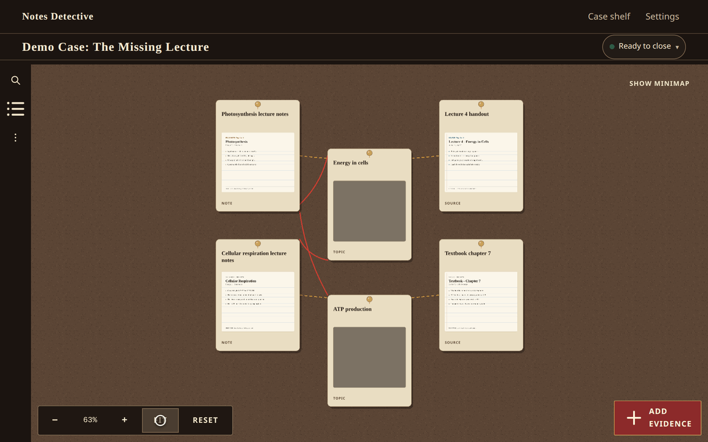
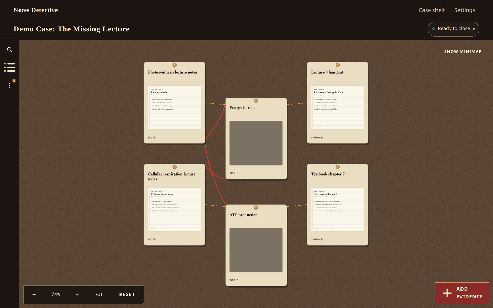
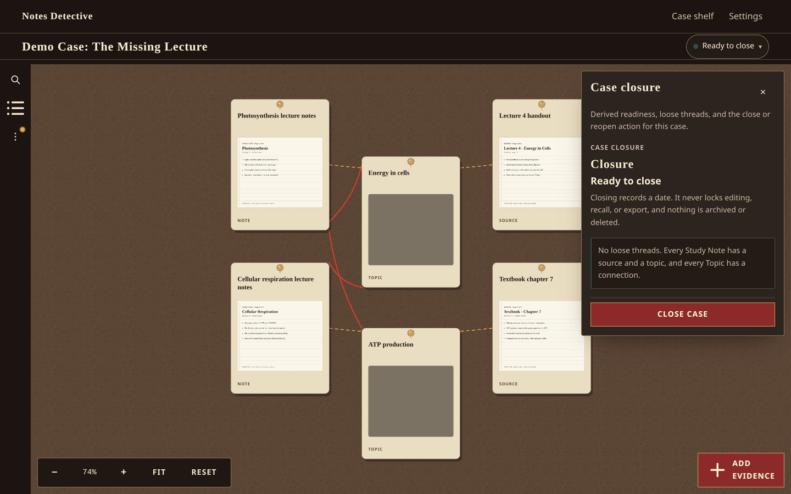
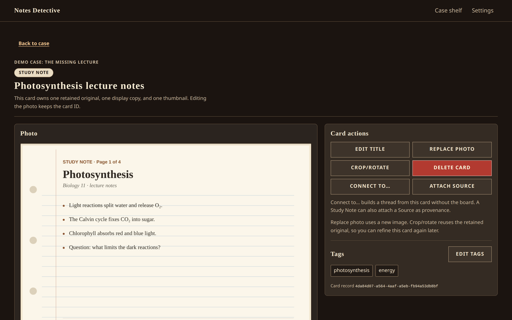
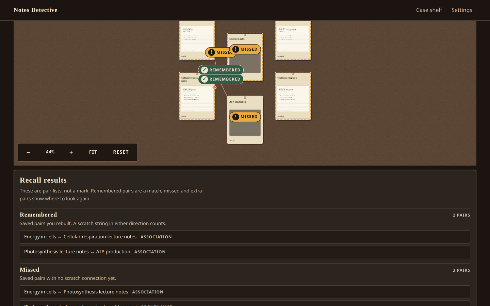
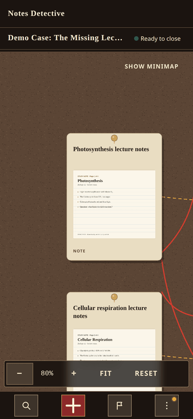

# Notes Detective

Notes Detective is an installable, offline-first exam-revision PWA. It turns photographed
lecture notes, sources, and topics into a detective evidence board: pin cards, draw association
and provenance strings, close a case only when its structure is complete, and rehearse the
connections from memory in recall mode.

Everything runs in the browser on the device. There is no account, backend, upload, telemetry,
or remote copy of a case.



## What this is

- **Evidence capture.** Import photos, crop and rotate them, and attach them to Study Note,
  Source, or Topic cards.
- **Case board.** Pan and zoom a cork board, pin cards, and draw undirected strings with an
  association or provenance type.
- **Closure.** A case is ready to close when every Study Note has provenance to a Source and an
  association to a Topic. Closing records a state; it never locks editing.
- **Recall.** Hide the truth strings, redraw connections on a scratch layer, and check for
  remembered, missed, extra, and type-mismatched pairs. There is no score, percentage, or grade.
- **Search and tags.** Find cards by title, tag, or stored OCR text.
- **Backup and restore.** Export one case to a versioned `.ndcase` ZIP and restore it as a copy or
  an explicit replacement.
- **Optional OCR.** Run bundled English text recognition on the device. OCR is user-triggered and
  only suggests a title; it never overwrites an edit.
- **First-run demo.** A clearly labeled demo case is seeded once when the install has no cases, so
  the board, strings, closure, and recall can be tried immediately.
- **Offline app shell.** After the first successful load, the shelf, board, recall, search, and
  OCR assets load from the service-worker cache.

## Screenshots

Every image is captured from the production build with the generated demo case. They contain no
personal notes, photos, account details, or third-party artwork.

| Case board                                                                          | Case closure                                                               |
| ----------------------------------------------------------------------------------- | -------------------------------------------------------------------------- |
|  |  |

| Card detail                                                                                      | Recall results                                                                                              |
| ------------------------------------------------------------------------------------------------ | ----------------------------------------------------------------------------------------------------------- |
|  |  |

The same case at phone width (390x844):



[Full-size phone screenshot](docs/media/phone-board.png)

Regenerate every image with `npm run media`. The capture script, its WebGL requirement, and the
size budget are documented in [docs/media/README.md](docs/media/README.md).

## Requirements

| Requirement | Detail                                                                                                                                                       |
| ----------- | ------------------------------------------------------------------------------------------------------------------------------------------------------------ |
| Node.js     | Node 24 LTS is the pinned release toolchain (`.nvmrc` contains `24`). The package also accepts Node 22.12 and newer, but CI and deployment use Node 24.      |
| npm         | Installs from the committed `package-lock.json` with `npm ci`.                                                                                               |
| Disk space  | Dependencies, Playwright browsers, and the bundled OCR worker, wasm, and English traineddata.                                                                |
| Browser     | A current browser with IndexedDB. Service workers, Web Workers, and WebAssembly unlock offline and OCR behavior; missing APIs produce a notice, not a crash. |
| Hosting     | GitHub Pages for the deployed site. No server, database, authentication service, function, or secret is required.                                            |

The OCR assets are copied into `public/ocr` by `scripts/copy-ocr-assets.mjs` from the pinned
`tesseract.js`, `tesseract.js-core`, and `@tesseract.js-data/eng` packages. `postinstall`,
`predev`, and `prebuild` run that copy automatically.

## Install

Clone the repository, then run the following from its root:

```bash
npm ci
npx playwright install --with-deps chromium firefox webkit
```

`npm ci` installs exactly the lockfile versions and runs the OCR asset copy. The Playwright install
is needed for the browser journeys; it can be skipped for unit-only work.

## Run locally

```bash
npm run dev
```

Open <http://localhost:5173/>. The first run seeds the demo case when the browser profile has no
cases. Cases, images, and settings live in that browser profile; a different browser or a cleared
site has a different shelf.

The dev server is for feature work. It is not evidence that the production build, base path,
service worker, or offline path works. Use the production preview below for those checks.

## Scripts

| Command                                | What it does                                                                                                              |
| -------------------------------------- | ------------------------------------------------------------------------------------------------------------------------- |
| `npm run dev`                          | Start the Vite development server.                                                                                        |
| `npm run build`                        | Typecheck with `tsc -b`, copy OCR assets, and emit the production build into `dist/`.                                     |
| `npm run preview`                      | Serve the existing `dist/` build locally; run a build first.                                                              |
| `npm run lint`                         | Run ESLint over the repository.                                                                                           |
| `npm run typecheck`                    | Run the TypeScript project build without emitting output.                                                                 |
| `npm run test`                         | Run the Vitest unit and component suite once.                                                                             |
| `npm run test:coverage`                | Run Vitest with V8 coverage and the domain/data thresholds.                                                               |
| `npm run test:e2e`                     | Build, then run the Playwright journeys against `vite preview` on port 4173.                                              |
| `npm run media`                        | Build, then capture the screenshots and demo GIF in `docs/media/` from the generated demo case.                           |
| `npm run validate:workflows`           | Check the CI workflow contract: Node version, required steps, and no bypass.                                              |
| `npm run format`                       | Format the repository with Prettier.                                                                                      |
| `npm run format:check`                 | Check formatting without writing.                                                                                         |
| `node scripts/check-pages-build.mjs`   | Verify that `dist/` is a valid GitHub Pages build with a prefixed base path and relative manifest scope.                  |
| `node scripts/check-bundle-budget.mjs` | Read the generated service-worker precache and fail above 25 MiB.                                                         |
| `node scripts/perf-budget.mjs`         | Read the Vite manifest and fail when initial JavaScript exceeds 300 KiB gzip, excluding lazy board and OCR chunks.        |
| `node scripts/check-release-docs.mjs`  | Check that `README.md` and `docs/RELEASE.md` are complete, link correctly, and contain no placeholder or forbidden claim. |
| `node scripts/check-ocr-assets.mjs`    | Verify that the bundled OCR worker, wasm, and traineddata files exist and stay same-origin.                               |

`npm run test:e2e` builds first, so a stale `dist/` cannot satisfy the browser suite. The Playwright
projects are Chromium at 1440x900, 1280x800, and 390x844, plus Firefox and WebKit at 1440x900 for
the compatibility smoke path.

## Quality checks

Run the release checks in this order. The Pages and bundle checks read build output, so build
first.

```bash
npm ci
npm run validate:workflows
npm run lint
npm run typecheck
npm run test:coverage
npm run build
npm run test:e2e

node scripts/perf-budget.mjs
node scripts/check-bundle-budget.mjs
node scripts/check-release-docs.mjs
```

For the GitHub Pages base path, use the exact build and checker shown under
[Production preview](#production-preview).

What the checks enforce:

- **Coverage:** `src/domain/**` and `src/data/**` must each reach at least 85 percent line
  coverage, and every matched file must be covered. A new domain or data file with no test fails
  the threshold even if the directory average is healthy.
- **Initial JavaScript:** at or below 300 KiB gzip for the Vite entry plus its static imports. Lazy
  board and OCR chunks are outside that budget.
- **Service-worker precache:** at or below 25 MiB for every precached shell, icon, lazy chunk, and
  OCR asset.
- **Pages artifact:** every built asset stays inside the configured base path, the manifest and
  icons exist, and `start_url`/`scope` stay relative.
- **Release docs:** required headings, local links, documented commands, and no unfinished
  placeholder text.

CI runs the same gate on Node 24 for every push and pull request: `npm ci`, workflow validation,
lint, typecheck, coverage, build, Playwright browser installation for Chromium, Firefox, and
WebKit, and the Playwright end-to-end suite. A pull request never deploys.

## Production preview

Build the production artifact, then serve it with Vite preview. The dev server is not a substitute.

### Default relative build

```bash
npm ci
npm run build
npm run preview
```

Open <http://localhost:4173/>. A direct hash route such as <http://localhost:4173/#/settings> loads
without a server rewrite because every route lives after `#`.

### GitHub Pages base-path build

Use the same base path for the build, the preview server, and the checker:

```bash
VITE_BASE_PATH=/notes-detective/ npm run build
npm run preview -- --base /notes-detective/
node scripts/check-pages-build.mjs --base /notes-detective/
```

Open <http://localhost:4173/notes-detective/> and then a direct route such as
<http://localhost:4173/notes-detective/#/settings>. If the repository has a different name,
substitute that name consistently in `VITE_BASE_PATH` and `--base`; the deploy workflow derives it
from the repository automatically.

`VITE_BASE_PATH` is build-time only. Changing it after a build has no effect; rebuild before
previewing or deploying. The full base-path contract, one-time Pages setup, and troubleshooting
table are in [docs/DEPLOYMENT.md](docs/DEPLOYMENT.md).

## Deploy to GitHub Pages

Deployment is automatic and main-only. `.github/workflows/deploy-pages.yml` runs on a push to
`main`, builds with `VITE_BASE_PATH` set to the repository name, runs
`node scripts/check-pages-build.mjs`, uploads `dist/` as the Pages artifact, and deploys it through
the `github-pages` environment. Pull requests run CI and never deploy.

One-time repository setup:

1. Open **Settings → Pages**.
2. Under **Build and deployment → Source**, choose **GitHub Actions**.
3. Keep `main` as the deployment branch and require the **Quality gate (Node 24)** status check on
   pull requests.
4. Optionally add protection rules to the `github-pages` environment.

GitHub Pages serves a project site at `https://ACCOUNT.github.io/REPOSITORY/`, where `ACCOUNT` and
`REPOSITORY` are the account and repository names. A hash route such as
`https://ACCOUNT.github.io/REPOSITORY/#/settings` loads directly; a path-style URL such as
`/REPOSITORY/settings` is not supported and does not need to be.

The workflow uses narrow permissions (`contents: read`, `pages: write`, `id-token: write`) and no
repository secret. The static host cannot set custom response headers, so the project does not
claim a custom header policy. Deployment proves that the artifact built with the right base path
and passed the Pages check; it does not prove that the product is useful or that the human
acceptance journey passed.

Step-by-step deployment details and failure symptoms are in
[docs/DEPLOYMENT.md](docs/DEPLOYMENT.md). The release gate is in
[docs/RELEASE.md](docs/RELEASE.md).

## Data and privacy

Notes Detective stores everything locally in IndexedDB:

| Store         | Contents                                                                                         |
| ------------- | ------------------------------------------------------------------------------------------------ |
| `cases`       | Case title, subject, exam date, closure state, viewport, demo marker, and backup reminder state. |
| `cards`       | Study Note, Source, and Topic records, positions, OCR text and confidence, and timestamps.       |
| `connections` | Association and provenance strings with their endpoint card IDs.                                 |
| `attachments` | Original, display, and thumbnail image Blobs for the cards in the case.                          |

The database is `notes-detective`, schema version 1, created and migrated by Dexie. Image bytes,
card titles, tags, OCR text, and backup files are never uploaded. OCR runs in a bundled Web Worker
with bundled wasm and English traineddata, using same-origin assets. There is no analytics,
telemetry, crash reporting, advertising SDK, CDN font, or third-party runtime script.

The browser requests the static app files from GitHub Pages, as it would for any website. Those
requests contain ordinary HTTP metadata; they never contain case content, image bytes, or OCR text.
The app asks for persistent storage when the first case is created and shows whether storage is
persistent or best effort. Persistence is a request, not a guarantee: the browser can still evict
site data. Export important cases.

There is no account, server database, authentication service, or multi-device copy. The device and
browser profile are the boundary.

## Backup and restore

Export one case from the case screen or the shelf row menu. The file is named
`<case-slug>-<yyyy-mm-dd>.ndcase` and is a ZIP containing `manifest.json` plus the case's image
attachments. The manifest records the archive format version, database schema version, app version,
case, cards, connections, tags, positions, closure state, and OCR fields. Every image entry has a
SHA-256 checksum and a safe relative path.

Import from the shelf. Before writing anything, the app validates the ZIP structure, manifest
schema and versions, checksums, paths, entry count, entry sizes, and duplicate names. The default
restore action is **Restore as a copy**, which assigns new IDs and leaves existing cases untouched.
Replacing an existing case by ID requires an explicit **Replace existing case** choice and a typed
confirmation, and the replacement is transactional. A failed import leaves the existing shelf
unchanged.

The archive is a plain ZIP file. It is not protected by a password, so anyone who obtains the file
can read the notes inside. Store backups somewhere you trust and delete old copies when they are no
longer needed. There is no whole-library export in v1: each archive contains exactly one case.

After a case reaches five cards and one connection, a non-blocking reminder offers a backup once
for that case. **Back up now** exports it; **Not now** dismisses the reminder for that case
permanently. The reminder never blocks editing.

## Browser support

The primary arranging target is a 10-inch tablet in landscape. Phone and desktop support the full
feature set, not a reduced one.

| Device                    | Viewport | Expectation                                                                                        |
| ------------------------- | -------- | -------------------------------------------------------------------------------------------------- |
| 10-inch tablet, landscape | 1280x800 | Primary board layout; no page-level horizontal scrolling; touch targets at least 44x44 CSS pixels. |
| Phone                     | 390x844  | Full capability with bottom sheets and compact board controls.                                     |
| Desktop                   | 1440x900 | Full capability, pointer board, and the complete keyboard path for non-spatial tasks.              |

| Browser | Desktop | Mobile                 | Automated evidence                                                                                             |
| ------- | ------- | ---------------------- | -------------------------------------------------------------------------------------------------------------- |
| Chrome  | Current | Android Chrome current | Full Playwright journeys at all three viewports.                                                               |
| Edge    | Current | —                      | Chromium-based; not a separate Playwright project.                                                             |
| Firefox | Current | —                      | `e2e/compat.spec.ts` smoke path at 1440x900.                                                                   |
| Safari  | Current | iOS Safari current     | Playwright WebKit smoke path at 1440x900. Real Safari and iOS Safari are human checks, not automated evidence. |

"Current" means the current stable release at the time of the review. The app checks required
capabilities on load and shows a non-blocking notice naming any missing one; the shelf still opens
where possible.

| Capability          | API                           | When missing                                                                        |
| ------------------- | ----------------------------- | ----------------------------------------------------------------------------------- |
| Local case storage  | IndexedDB                     | Cases and cards cannot be saved on this device.                                     |
| Offline app shell   | Service worker                | The app runs while the page is open but cannot reload from cache without a network. |
| Optional OCR        | Web Workers and WebAssembly   | OCR is unavailable; cards, board, search, recall, and backup still work.            |
| Storage persistence | `navigator.storage.persist()` | The shelf reports best-effort storage and keeps the backup path visible.            |
| Save dialog         | File System Access API        | Export falls back to a normal browser download.                                     |

Installation is browser-native. On Android Chrome and desktop Chromium browsers, use the install
prompt or the browser menu. On iOS Safari, use **Share → Add to Home Screen**. After the first
successful load, the installed app opens from the service-worker cache and can reload offline.

## Known limitations

- **Spatial editing is pointer-only.** Placing, panning, and scratch drawing on the board require a
  pointer. The card list, card detail, connection picker, search, and recall results are
  keyboard-operable alternatives for the non-spatial work; they do not reproduce the spatial
  canvas. The board has an accessible name, description, and a visible **Open card list** action.
- **OCR is English-only and handwriting-dependent.** Recognition is user-triggered, runs locally,
  and only pre-fills a title suggestion. Accuracy on handwriting varies and can be poor.
- **Backups are plain ZIP files.** They are not protected by a password. Treat a `.ndcase` file as
  private notes.
- **Storage can be evicted.** Persistent storage is best-effort, not permanent. Export important
  cases.
- **First load needs a network.** Offline behavior starts after the first successful load and
  service-worker install. There is no offline installer.
- **GitHub Pages is static.** There is no backend, server rewrite, custom response header, or
  server-side session. Routing is hash-based, and the project does not claim a custom header
  policy.
- **Cross-browser coverage is uneven.** The full automated journey runs in Chromium at three
  viewports. Firefox and WebKit run a smoke path at desktop size, so use the human journey for
  real-device confidence.
- **The board target is 150 cards.** The app warns softly at 120 cards and persistently at 150 or
  more and never imposes a hard cap below 200. Older tablets can still drop frames at the upper
  end; the tablet frame-rate check is a human gate.
- **There is one local install per browser profile.** Cases do not follow a student to another
  device. Moving a case means exporting it and importing it on the other device.
- **v1 excludes PDF import, photo annotation, typed note bodies, multi-image cards, card colors,
  string labels, cross-case card reuse, case duplication, and whole-library export.**
- **Updates wait for confirmation.** A new service worker stays waiting until the in-app
  **Refresh** action is used; it does not activate silently during an open form.
- **No remote diagnostics.** With no telemetry, a defect must be reproduced locally and described
  in the review; there is no crash report to inspect.

## Documentation

- [Product overview](README.md#what-this-is)
- [Deployment guide](docs/DEPLOYMENT.md)
- [Release notes and checklist](docs/RELEASE.md)
- [Support team and ownership](docs/SUPPORT.md)
- [Performance budget notes](docs/quality/performance-budget.md)
- [Media capture notes](docs/media/README.md)

The human acceptance record is written to `docs/reviews/final-acceptance.json` by the reviewer. It
is not generated by CI and is not created by an agent. The release is not accepted until that
record exists and answers the hard success signal.
